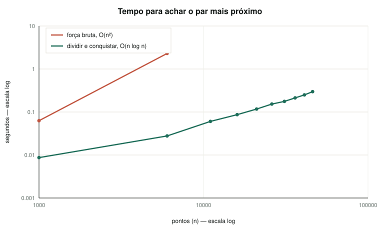

# Par de Pontos mais Próximos na base do CNES

**Número do Grupo:** 31 &nbsp;·&nbsp; **Conteúdo da Disciplina:** Dividir e Conquistar

Entre os 46 mil estabelecimentos de saúde do Brasil, quais dois serviços
distintos estão mais perto um do outro?

## Alunos

| Matrícula | Aluno |
| --- | --- |
| 222006534 | Anna Clara Cardoso Evangelista Brandão |
| 231026699 | Eduarda Domingos Rodrigues |

## Sobre

A base do CNES tem **46.059 estabelecimentos de saúde com coordenada válida** no
Brasil. A pergunta ingênua — quais dois pontos estão mais perto — tem resposta
decepcionante: **zero metros**, porque há cadastros repetidos na mesma
coordenada. E para achar isso não é preciso algoritmo nenhum: uma tabela hash
resolve em centésimos de segundo.

A pergunta que exige o algoritmo é outra: **qual o par mais próximo acima de um
limiar**. Aí não basta saber se dois pontos são iguais, é preciso saber qual é o
mais próximo — e a força bruta levaria mais de mil milhões de comparações.

## Apresentação

[](https://www.youtube.com/watch?v=5Z1TFtjznRI)

## Os dados

Os arquivos brutos não são versionados.

### Estabelecimentos de saúde — CNES, Ministério da Saúde

Baixe o CSV do CNES e salve como
`data/raw/Unidades_Basicas_Saude-UBS.csv`:

<https://dadosabertos.saude.gov.br/dataset/unidades-basicas-de-saude-ubs>

Conferência — `python -m src.dados` deve imprimir:

| | |
| --- | --- |
| Registros no Brasil | 47.983 |
| **Com coordenada válida** | **46.059** |
| Unidades da federação | 27 |
| Coordenadas repetidas | 486, envolvendo 1.254 registros |
| Maior empilhamento | 33 estabelecimentos no mesmo ponto |

**Armadilha do separador decimal.** A coluna `LATITUDE` usa ponto e a `LONGITUDE`
usa vírgula, no arquivo nacional inteiro. Sem trocar a vírgula por ponto, todo
`float()` de longitude estoura. Tem teste próprio.

**A base só traz códigos.** `UF` e `IBGE` são códigos numéricos, não nomes.

Os **27 códigos de unidade da federação** estão em `src/ufs.py`, e não vieram
de memória: conferimos cada um contra as coordenadas da própria base. Roraima e
Amapá são os dois únicos com latitude média positiva, o Acre é o mais a oeste, o
Rio Grande do Sul o mais ao sul, e o Distrito Federal tem exatamente 200
estabelecimentos — o mesmo número do nosso trabalho anterior. Tem teste próprio.

Os **nomes de município** não cabem no código: são 5.570. Se o arquivo
`data/municipios_ibge.csv` existir, com as colunas `codigo;nome` separadas por
ponto e vírgula, os nomes aparecem nas saídas; sem ele, sai o código. A tabela
está em <https://servicodados.ibge.gov.br/api/v1/localidades/municipios>.

### Setores censitários — Censo 2022, IBGE

Só a **extensão das inversões** precisa deste arquivo; o algoritmo principal não.

<https://ftp.ibge.gov.br/Censos/Censo_Demografico_2022/Agregados_por_Setores_Censitarios/malha_com_atributos/setores/shp/UF/DF/DF_setores_CD2022.zip>

**Descompacte**, deixando os cinco arquivos (`.shp`, `.dbf`, `.shx`, `.prj`,
`.cpg`) soltos em `data/raw/`. São 2,5 MB: é o arquivo do DF, não o nacional, e
o `.dbf` já traz a população junto da geometria.

Conferência — `python -m src.setores` deve imprimir 5.418 setores, 2.817.381
habitantes, 5.021 urbanos e 397 rurais, em 33 regiões administrativas.

O shapefile está em SIRGAS 2000 geográfico, ou seja já em latitude e longitude.
Lemos com `pyshp` e reduzimos cada setor ao centro do seu polígono, pela fórmula
do shoelace em `src/geometria.py`.

## A geometria

O algoritmo clássico é **plano e euclidiano**; a Terra não é. Projetamos com

```
x = longitude × cos(latitude de referência) × 111
y = latitude × 111
```

onde a latitude de referência é a média do conjunto.

**O cosseno é da referência, não de cada ponto.** Essa distinção não é detalhe:
usando o cosseno da latitude de cada ponto, a coordenada `x` passa a depender da
latitude, e como a longitude no Brasil vale cerca de −48, andar um grau para o
sul desloca o ponto 25 km para o lado no mapa. Medimos o estrago: **11% de erro
na distância, em qualquer escala**. Com a latitude de referência o erro some.

**O que isso custa.** Numa nuvem de poucos quilômetros — a escala em que as
respostas deste trabalho acontecem — o par escolhido é exatamente o mesmo que a
distância de haversine escolheria: medimos erro **zero**. Espalhando pontos pelo
país inteiro, a projeção chega a errar **4,9%** e pode trocar o par vencedor. A
resposta final é sempre reportada em haversine, a distância de verdade sobre a
esfera.

## O algoritmo

A força bruta compara todos os pares: com 46.059 pontos são **1.060.692.711**
comparações. O dividir e conquistar resolve o mesmo problema em três passos.

**1. Dividir.** Ordena os pontos pela coordenada horizontal e corta no meio, com
uma linha vertical deixando metade dos pontos de cada lado.

**2. Conquistar.** Resolve cada metade recursivamente e guarda a menor das duas
distâncias encontradas. Chame ela de **d**.

**3. Combinar.** O par mais próximo ainda pode ter um ponto de cada lado — mas
só se os dois estiverem a menos de **d** da linha de corte. Basta olhar uma
faixa de largura `2d` em volta dela.

### Por que a faixa não custa caro

O passo 3 parece ser onde o algoritmo se perde: a faixa pode conter todos os
pontos. O que salva é a ordem.

Percorrendo a faixa **ordenada pela coordenada vertical**, cada ponto só precisa
ser comparado com os seguintes enquanto a diferença vertical for menor que
**d** — passou disso, nenhum ponto adiante pode formar par melhor, e a varredura
para.

E esse pedaço é curto. Considere o retângulo de `2d` por `d` à frente de um
ponto da faixa: como as duas metades já foram resolvidas, **não há dois pontos
do mesmo lado a menos de d um do outro**. Dividindo o retângulo em quadrados de
lado `d/2`, cada quadrado cabe no máximo um ponto, e são oito quadrados. Logo, no
máximo **sete vizinhos** a examinar por ponto. Sete é constante, a combinação
fica linear, e o total é **O(n log n)**.

### O limiar derruba esse argumento

Quando se pede o par mais próximo **acima de um limiar**, o `minimo_km`, aquele
raciocínio deixa de valer. Ele depende de não existirem dois pontos a menos de
**d** do mesmo lado — e é exatamente isso que o limiar permite: pares colados
são descartados da resposta, mas os pontos continuam lá, ocupando a faixa e
empurrando os vizinhos de verdade para fora da janela de sete.

Alargar a janela não conserta, porque o número de pontos que cabem no retângulo
deixa de ter limite fixo: depende de quão coladas as duplicatas estão. A solução
correta é **não ter janela**: a varredura para apenas pela diferença vertical,
que é o que de fato garante a corretude. Com dados sem duplicatas o efeito é o
mesmo, porque a parada acontece no sétimo vizinho de qualquer jeito.

O custo disso é que, numa base com muitos pontos empilhados, a faixa pode ficar
cara. Na base do CNES isso não acontece — as 46 mil comparações levam menos de
um segundo —, mas é uma limitação real e fica registrada aqui.

### Onde isso está

`src/par_proximo.py`. A função pública é

```
par_mais_proximo(pontos, minimo_km=0.0) -> (distancia_km, (i, j))
```

Ela recebe latitudes e longitudes, projeta, roda a recursão no plano e devolve
os índices do par junto com a distância **de haversine** entre eles — a
distância de verdade sobre a esfera, não a do plano.

O caso base da recursão é a própria força bruta, para três pontos ou menos. É a
mesma ideia que `src/forca_bruta.py` aplica à base inteira, e é o que permite
afirmar que os dois concordam.

## A extensão: Contagem de Inversões

Item **3.2** da ementa. É o mesmo esqueleto de dividir e conquistar com um
passo de combinação diferente: em vez de varrer uma faixa em volta da linha de
corte, conta os pares fora de ordem enquanto intercala as duas metades já
ordenadas. Quando um elemento da direita entra na frente de `k` elementos que
ainda restam na esquerda, ele está invertido com os `k` de uma vez — é essa
contagem em bloco que troca o O(n²) da contagem ingênua por **O(n log n)**.

**A pergunta:** onde mora mais gente, a saúde está mais perto?

Ordenamos os 5.418 setores censitários do DF por população e por distância até
a unidade de saúde mais próxima, e contamos as inversões entre os dois
rankings. Uma inversão aqui é um par **discordante**: o setor mais populoso é
também o mais distante. Se os dois rankings não tivessem relação nenhuma,
metade dos pares seria discordante.

São 14.674.653 pares. Percorrer todos é exatamente o que o merge evita. O
resultado está na seção **Achados**, logo abaixo.

### Onde isso está

`src/inversoes.py`:

```
contar_inversoes(valores) -> int
comparar_rankings(populacoes, distancias) -> Concordancia
distancia_ate_a_mais_proxima(pontos, unidades) -> list[float]
```

Empates de população ficam fora da conta: dois setores com a mesma população
não concordam nem discordam. Por isso `Concordancia` separa `pares`,
`empatados` e `comparaveis`, e a fração discordante é calculada sobre os
comparáveis. São 21.482 empates — jogá-los para um dos lados mudaria o
resultado na terceira casa.

```bash
python -m src.inversoes
```

`tests/test_inversoes.py`, 18 testes. A contagem é conferida contra uma
contagem na marra, escrita à parte dentro do próprio arquivo de teste, em 20
listas sorteadas.

## A força bruta e a validação

`src/forca_bruta.py` compara todos os pares, O(n²), e existe para ser a régua.
Ela tem **exatamente a mesma assinatura** do dividir e conquistar:

```
par_mais_proximo(pontos, minimo_km=0.0) -> (distancia_km, (i, j))
```

É isso que permite trocar uma pela outra dentro de um teste e exigir a mesma
resposta. `tests/test_forca_bruta.py` cruza as duas em **35 instâncias** — com
e sem limiar, incluindo conjuntos carregados de duplicatas — e ainda confere a
própria força bruta contra uma terceira contagem, independente, escrita dentro
do arquivo de teste.

### A curva de tempo

`src/validacao.py` roda os dois algoritmos sobre prefixos de uma mesma ordem
embaralhada e grava tudo em `resultados/`:

```bash
python -m src.validacao
```

| pontos | dividir e conquistar | força bruta | ganho |
| --- | --- | --- | --- |
| 1.000 | 0,004 s | 0,048 s | 11× |
| 6.007 | 0,022 s | 1,777 s | **80×** |
| 11.013 | 0,044 s | — | — |
| 21.026 | 0,088 s | — | — |
| 31.039 | 0,141 s | — | — |
| 46.059 | **0,280 s** | — | — |

A força bruta para em 10.000 pontos por padrão, porque daí em diante ela domina
o tempo do experimento inteiro: nos 46.059 pontos ela leva **214 segundos**.

Os tempos acima são de uma execução só, e mudam de máquina para máquina. O que
não muda é a relação entre as duas curvas, e é ela que o gráfico mostra.



Com os dois eixos em escala log, a inclinação da reta **é** o expoente.
Medindo entre o primeiro e o último ponto de cada curva:

| | inclinação medida | teoria |
| --- | --- | --- |
| força bruta | **2,02** | 2 |
| dividir e conquistar | **1,08** | 1, mais o fator log |

Não é uma figura ilustrativa: são as duas complexidades aparecendo na medição.

### A tabela hash, para manter a honestidade

O mesmo comando mede o que uma tabela hash faz com a pergunta ingênua:

| | tempo |
| --- | --- |
| tabela hash, achar coordenadas repetidas | **0,008 s** |
| dividir e conquistar, sem limiar | 0,220 s |

Trinta vezes mais rápido, e dá a mesma resposta — **zero metros** — porque sem
limiar a pergunta é só "existe duplicata?". É por isso que o trabalho pergunta
outra coisa. A tabela com as respostas acima de 1 m, 10 m e 100 m sai no mesmo
relatório, em `resultados/validacao.md`.

`tests/test_validacao.py`, 24 testes.

## Achados

**O par mais próximo do Brasil está a distância zero — e isso é cadastro, não
geografia.** São 486 coordenadas repetidas cobrindo 1.254 registros, com 33
estabelecimentos empilhados num único ponto em Rio Branco.

**E achar isso não precisa de algoritmo.** Uma tabela hash encontra as
duplicatas em centésimos de segundo, mais rápido que o dividir e conquistar. É
por isso que a pergunta do trabalho é outra: o par mais próximo **acima de um
limiar**, que a tabela hash não sabe responder.

**Não existe um vão separando duplicata de serviço distinto.** As respostas
caem quase coladas no limiar — 1,02 m acima de 1 m, 10,03 m acima de 10 m,
100,44 m acima de 100 m — e os dois estabelecimentos de cada par estão sempre no
mesmo município. É um contínuo, e onde cortar é decisão documentada, não um fato
dos dados.

**O ganho do algoritmo é de três ordens de grandeza.** 214 segundos de força
bruta contra 0,26 segundo, com a mesma resposta — verificada a cada `unittest`,
não só uma vez.

### Onde mora mais gente, a saúde está mais perto — um pouco

Nos 5.418 setores censitários do DF, de 14.653.171 pares comparáveis,
**6.503.928 são discordantes: 44,4%**. Rankings independentes dariam 50%. Em
tau de Kendall isso é **+0,11**, com erro padrão de 0,0091 — **doze desvios
padrão** de distância do acaso.

A associação é fraca, e é real: setor mais populoso tende a ter unidade de saúde
mais perto.

### A unidade de análise mudou a conclusão

Uma estimativa nossa anterior, feita sobre as **33 regiões administrativas** com
distância média ponderada por população, deu metade exata — tau zero, rankings
independentes. Ficou registrada no plano como suspeita a conferir, justamente
por ser redonda demais.

Não se sustentou. **Agregar 5.418 setores em 33 blocos lava o sinal:** dentro de
uma região grande como Ceilândia a variação entre setores some na média. No
nível do setor o sinal aparece.

O número foi conferido por dois caminhos independentes — pelo `src/inversoes.py`
e por contagem direta de pares numa amostra de 1.200 setores, sem usar o
algoritmo — e os dois batem na quarta casa decimal.

Essa é a lição que a gente leva do trabalho junto com o algoritmo: a escolha da
unidade de análise mudou a resposta de "não há relação" para "há relação".

## Instalação

Requer **Python 3.10 ou mais novo**. Os comandos rodam da raiz do repositório.

```bash
python -m venv .venv
source .venv/bin/activate          # Windows: .venv\Scripts\Activate.ps1
pip install -r requirements.txt
```

## Uso

A interface, com o mapa e os controles:

```bash
streamlit run app.py
```

Os módulos também rodam sozinhos pela linha de comando:

```bash
python -m src.dados                 # confere o carregamento da base do CNES
python -m src.setores               # confere os setores censitários do DF
python -m src.par_proximo           # o par mais próximo, sem limiar
python -m src.par_proximo 0.001     # o par mais próximo acima de 1 metro
python -m src.inversoes             # a extensão: população contra acesso
python -m src.validacao             # a curva de tempo e o relatório
```

O `src.validacao` grava a curva de tempo, os gráficos e a tabela em
`resultados/`.

## Testes

```bash
python -m unittest discover
```

São 126 testes. Os que dependem dos arquivos brutos são pulados quando eles não
estão em `data/raw/`, então a suíte roda num clone recém-feito, sem download.

Um deles, `tests/test_modulos.py`, existe por causa de um susto: em 29/10 o
repositório ficou com três arquivos importando dois módulos que não existiam, e
**a suíte passava assim**, porque nenhum teste importava aqueles módulos. Agora
há um teste que importa todo módulo de `src/` e confere todo `from src...` do
projeto contra os módulos que existem de fato.

## Trabalho anterior do grupo

A distância de haversine e a leitura do CSV do CNES vêm do nosso trabalho de
Algoritmos Gulosos, em
[G31_Greedy_PA-26.2](https://github.com/projeto-de-algoritmos-2026/G31_Greedy_PA-26.2).
Aqui a base é usada inteira, e não só a parte do Distrito Federal.

## Referências

- KLEINBERG, J.; TARDOS, É. *Algorithm Design*, cap. 5 — Divide and Conquer.
- CORMEN, T. H. et al. *Introduction to Algorithms*, 3. ed., cap. 4 e 33.4.
- [Estabelecimentos de saúde — Portal de Dados Abertos do SUS](https://dadosabertos.saude.gov.br/dataset/unidades-basicas-de-saude-ubs)
