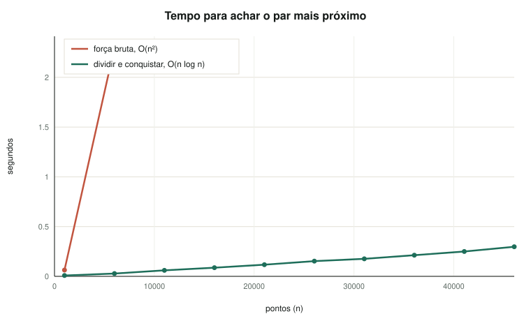
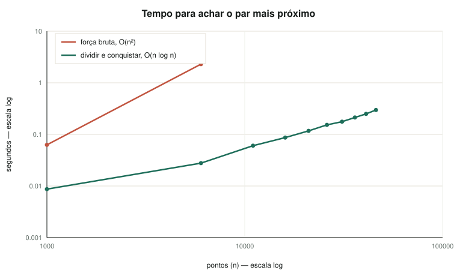

# Validação do dividir e conquistar — 46.059 pontos

## 1. Curva de tempo

Prefixos de uma mesma ordem embaralhada (semente 0), ignorando pares a 1 m ou menos.

| pontos | dividir e conquistar | força bruta | ganho | mesma distância? |
| --- | --- | --- | --- | --- |
| 1.000 | 0,009 s | 0,063 s | 7× | sim |
| 6.007 | 0,028 s | 2,298 s | 83× | sim |
| 11.013 | 0,060 s | — | — | — |
| 16.020 | 0,087 s | — | — | — |
| 21.026 | 0,117 s | — | — | — |
| 26.033 | 0,153 s | — | — | — |
| 31.039 | 0,176 s | — | — | — |
| 36.046 | 0,213 s | — | — | — |
| 41.052 | 0,250 s | — | — | — |
| 46.059 | 0,297 s | — | — | — |

## 2. A tabela hash acha as duplicatas

486 coordenadas repetidas, 1.254 registros envolvidos, maior empilhamento de 33.

| | tempo |
| --- | --- |
| tabela hash | 0,007 s |
| dividir e conquistar (sem limiar) | 0,263 s |

## 3. O par mais próximo acima de um limiar

| acima de | distância | tempo | par |
| --- | --- | --- | --- |
| 1 m | 1,02 m | 0,274 s | PS NOSSA SENHORA DE FATIMA — Piauí (município IBGE 221040) · UBS ILHA — Piauí (município IBGE 221040) |
| 10 m | 10,03 m | 0,280 s | UNIDADE AMBULATORIAL EXTENSAO HMSAD — Goiás (município IBGE 521975) · UBS VILA SAO LUIS ESF 04 — Goiás (município IBGE 521975) |
| 100 m | 100,44 m | 0,318 s | CENTRO DE SAUDE DE PIRAI DO NORTE — Bahia (município IBGE 292467) · USF AILTON VEIGA DE ARAUJO — Bahia (município IBGE 292467) |
